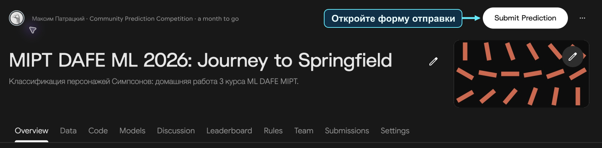
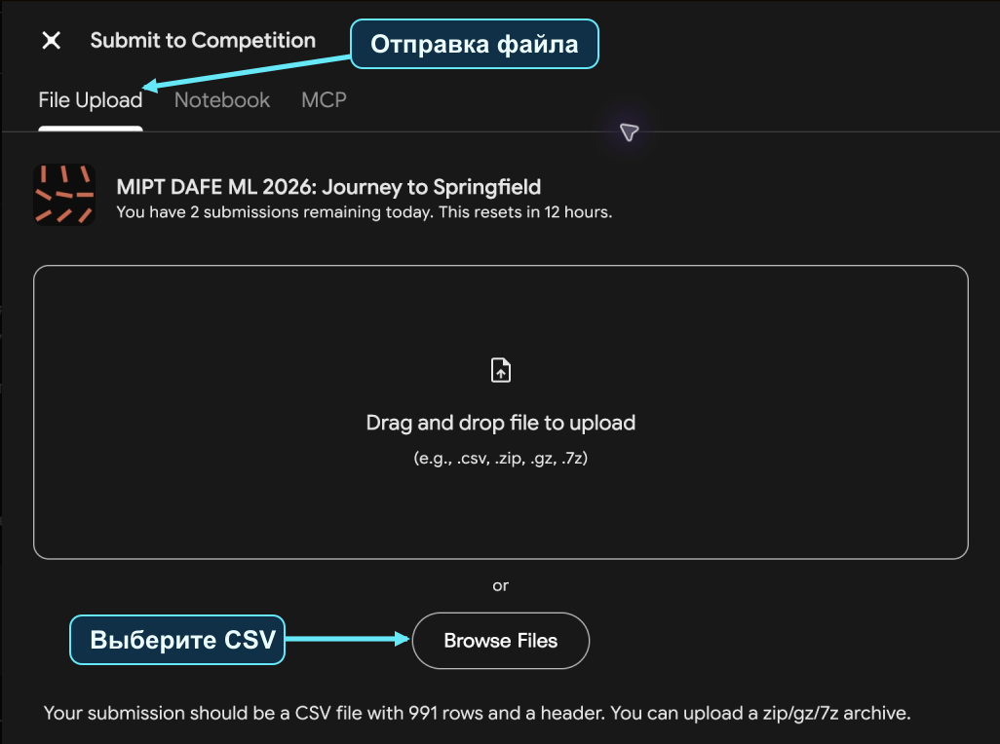
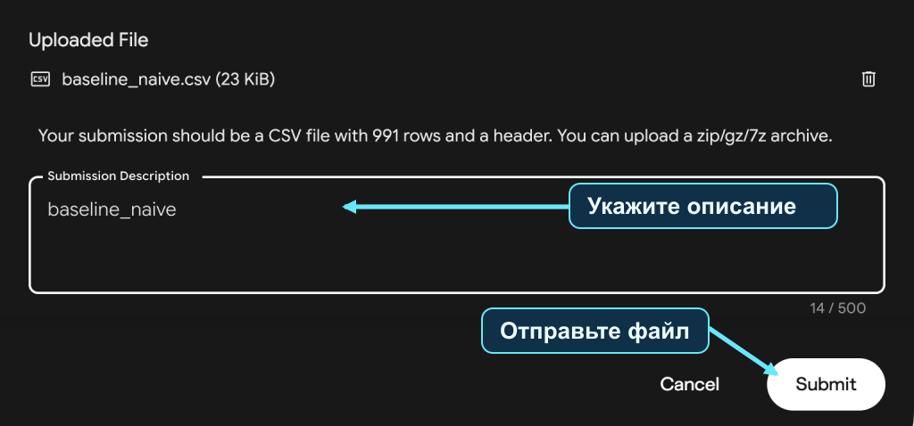
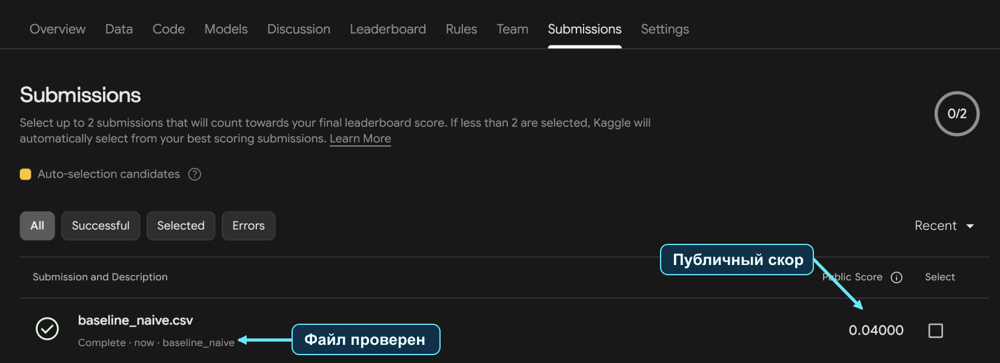

# Как отправить решение в Kaggle

[Вступите в соревнование курса](https://www.kaggle.com/t/a57d062186f245dab0a4c89f28cf4250).
Войдите в свой аккаунт и прочитайте правила через **Join Competition**.
Все отправки для HW3 делайте в соревнование **MIPT DAFE ML 2026: Journey to Springfield**.

## 1. Получите CSV

В [ноутбуке бейзлайна на Kaggle](https://www.kaggle.com/code/ampiro/mipt-dafe-ml-2026-baseline-naive)
нажмите **Copy & Edit** и выполните ячейки. Данные соревнования уже подключены.
В каталоге результатов `/kaggle/working` появится `baseline_naive.csv`. Скачайте этот файл.

Для локального запуска скачайте `sample_submission.csv` на вкладке **Data** и
выполните [baseline_naive.ipynb](baseline_naive.ipynb). Укажите путь к образцу
переменной окружения `HW3_SAMPLE_SUBMISSION`.

У файла 991 строка с предсказаниями и заголовок `Id,Expected`. В `Id` остаются
имена файлов из образца, в `Expected` записываются имена классов. Сохраняйте
через `to_csv(..., index=False)`.

## 2. Откройте форму отправки

На странице конкурса нажмите **Submit Prediction**.



На вкладке **File Upload** нажмите **Browse Files** и выберите `baseline_naive.csv`.



Напишите описание посылки. Для своей модели укажите название эксперимента или
версию кода, чтобы потом найти нужную отправку. Нажмите **Submit**.



## 3. Проверьте скор

На вкладке **Submissions** дождитесь статуса **Complete** и проверьте **Public Score**.
Для константы `bart_simpson` он равен **0.04000**. Если Kaggle показывает ошибку,
откройте посылку и прочитайте сообщение.



На вкладке **Leaderboard** сравните результат своей команды с бейзлайном.
Публичный скор рассчитан на 50 изображениях. Для итогового рейтинга Kaggle
пересчитает скор на 941 изображении приватной части. В **Submissions** можно
отметить до двух посылок для итогового зачёта.

## 4. Отправка через CLI

После вступления в конкурс можно отправить тот же CSV из терминала.
Установите Kaggle CLI и войдите в тот же аккаунт.

```bash
python -m pip install --upgrade kaggle
kaggle auth login
```

Запустите команду из каталога с CSV или укажите путь к файлу после `-f`.

```bash
kaggle competitions submit mipt-dafe-ml-2026-simpsons -f baseline_naive.csv -m "baseline_naive" --wait 120
```

Для своей модели укажите её CSV и описание запуска. CLI напечатает `Submission ref`.
Если проверка занимает дольше, получите статус по напечатанному номеру.
В примере `12345678` нужно заменить на свой номер.

```bash
kaggle competitions submission 12345678
kaggle competitions submissions mipt-dafe-ml-2026-simpsons
```

[Установка и вход](https://github.com/Kaggle/kaggle-cli/blob/main/docs/README.md).
[Команды для соревнований](https://github.com/Kaggle/kaggle-cli/blob/main/skills/references/competitions.md#kaggle-competitions-submit).

## 5. Отправьте предсказания своей модели

Замените константу `bart_simpson` предсказанными именами классов. Каждый
`Id` должен получить предсказание для соответствующей картинки. Для модели на PyTorch используйте `eval()` и контекст без градиентов.

В отчёте сохраните описание посылки, публичный скор, имя файла сохранённой модели и
идентификатор коммита. На защите по ним должно быть понятно, как воспроизвести
предсказания.
